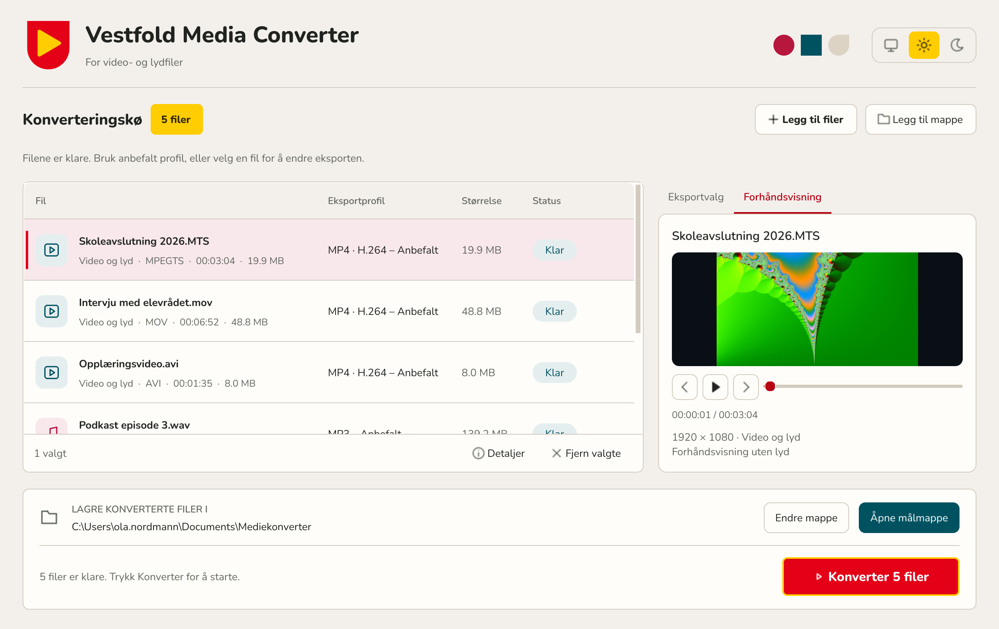
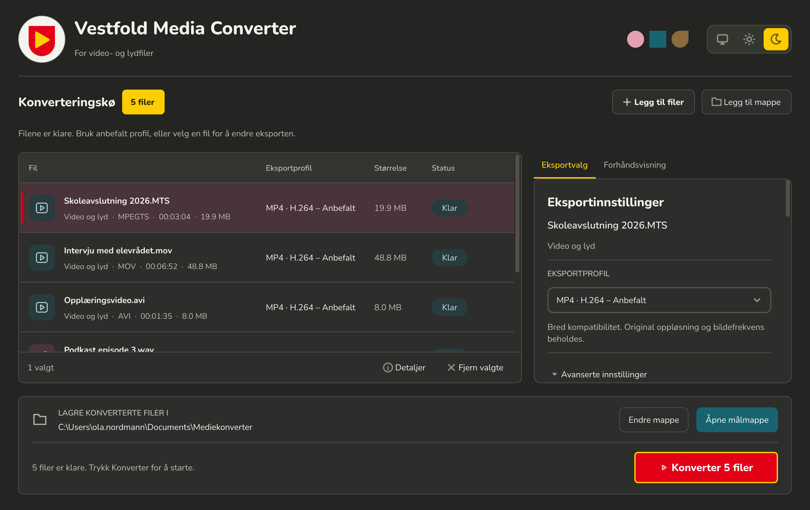
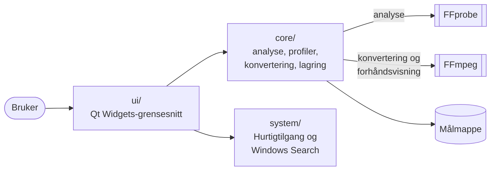

# Vestfold Media Converter

**Portabel konvertering av video og lyd for Windows, med norsk grensesnitt og uten installasjon.**



Vestfold Media Converter (VMC) gjør video- og lydfiler om til formater som virker overalt, uten at brukeren trenger å kunne noe om kodeker. Dra inn filene og trykk **Konverter**. Programmet velger en trygg standard for hver fil: MP4 for video og MP3 for lyd. Du kan også velge en annen profil eller justere detaljene selv.

Typiske eksempler er videoopptak fra kamera (MTS/M2TS), skjermopptak, intervjuer i MOV eller AVI og lydopptak i WAV som skal deles, publiseres eller lastes opp.

| | |
|---|---|
| **Versjon** | 1.0.0 |
| **Plattform** | Windows x64. Portabel programmappe, ingen installasjon. |
| **Rettigheter** | Kjører som vanlig bruker. Krever ikke administrator. |
| **Nettverk** | Ingen. Ingen telemetri, oppdateringssjekk eller skytjenester. |
| **Avhengigheter** | Ingen hos brukeren. Python, Qt, FFmpeg og fonten følger med i mappen. |
| **Språk** | Norsk (bokmål), med vanlige engelske fagord. |
| **Lisens** | GPL-3.0-or-later |

## Slik brukes programmet

1. Åpne `VestfoldMediaConverter.exe` fra programmappen.
2. Dra inn en fil, flere filer eller en hel mappe, eller bruk **Legg til filer** og **Legg til mappe**.
3. Trykk **Konverter**.

Ferdige filer lagres i `Dokumenter\Mediekonverter`. Mappen kan endres med **Endre mappe**, og **Åpne målmappe** viser resultatet i Utforsker. Originalfilene endres aldri.

| Kilde | Blir som standard |
|---|---|
| Video | **MP4 · H.264** (CRF 21, AAC-LC 192 kbit/s, yuv420p, faststart) |
| Video i 4K eller større | **MP4 · H.265** (CRF 24) |
| Lyd | **MP3** (192 kbit/s) |

En MTS-fil med AC-3-lyd blir dermed en MP4 med H.264 og AAC, og en WAV-fil blir MP3. Albumgrafikk gjør ikke en lydfil til video.

## Funksjoner

### Import og filbrowser

- Dra og slipp filer og mapper rett inn i vinduet.
- Innebygd filbrowser (**Ctrl+O**) med liste- og rutenettvisning, forhåndsvisning av markert video og flervalg med Ctrl/Shift.
- Klikkbar mappesti med tilbake, frem og opp én mappe. **Ctrl+L** åpner et adressefelt der du kan lime inn en sti.
- Snarveier fra Windows Hurtigtilgang, standardmapper og stasjoner. **Utforsker …** åpner den vanlige Windows-filvelgeren.
- Filnavnsøk i Windows Search-indeksen, i gjeldende mappe eller på hele PC-en. Søket kan avgrenses på type, filtype, størrelse, endringsdato og navn.
- Som standard vises bare mediefiler. **Vis alle filtyper** viser alle filer.

### Konverteringskø

- Viser filnavn, medietype, originalformat, varighet, størrelse, eksportprofil og status for hver fil.
- Flere filer konverteres i rekkefølge, med fremdrift per fil.
- Profilvalg gjelder de valgte radene, så filer i samme kø kan få ulike formater.
- **Avbryt** stopper jobben som pågår. Filer som allerede er ferdige, beholdes.
- **Detaljer** viser filstier og eventuelle feilmeldinger. **Delete** fjerner valgte rader.

### Forhåndsvisning

- Video vises uten lyd, med avspilling, hopp på fem sekunder og en tidslinje.
- Lydfiler kan spilles av med lyd gjennom Windows sin innebygde lydutgang.
- Forhåndsvisningen dekodes av den medfølgende FFmpeg og bruker ikke kodeker som er installert i Windows. Den er begrenset til 640 × 360 og 12 bilder/s for å spare ressurser, og ingenting lagres på disk.

### Eksportvalg



- Ferdige profiler for vanlige behov. Se [Støttede formater](#støttede-formater).
- **Avanserte innstillinger** gir kontroll over container, kodek, kvalitet/bitrate, preset, oppløsning, bildefrekvens, sideforhold, deinterlacing, pikselformat, lydspor, samplingsfrekvens, mono/stereo og bitdybde.
- Bare kombinasjoner av container og kodek som faktisk virker, kan velges.
- Maskinvarekoding med NVIDIA (NVENC), Intel (Quick Sync) og AMD (AMF) vises når FFmpeg støtter det. Det krever fungerende grafikkort og driver. Hvis koding med grafikkortet feiler, får brukeren en forklaring. Programmet bytter aldri til CPU av seg selv.

### Utseende

- Lyst, mørkt eller systemets tema, valgt med tre ikoner øverst til høyre.
- Farger fra Vestfold-våpenskjoldet og fonten Nunito, som følger med programmet. Se [visuell retning](docs/DESIGN.md).
- Skarp tekst og skarpe ikoner ved 100, 125 og 150 % skalering i Windows.
- Vinduet tilpasser seg skjermen ved oppstart. På lave skjermer brukes et mer kompakt oppsett.

## Støttede formater

### Inn

Programmet kan lese alt den medfølgende FFmpeg-versjonen kan dekode. Filbrowseren og søket viser disse filtypene:

| Type | Filendelser |
|---|---|
| Video | MP4, MOV, MKV, AVI, WebM, MTS, M2TS, TS, MXF, MPG, MPEG, M4V, WMV, 3GP, VOB, FLV |
| Lyd | WAV, MP3, FLAC, M4A, AAC, Opus, OGG, AIF, AIFF, WMA, ALAC |

### Ut: ferdige profiler

| Profil | Format | Passer til |
|---|---|---|
| MP4 · H.264 – Anbefalt | MP4, H.264 + AAC | Deling og avspilling overalt |
| MP4 · H.265 – mindre fil | MP4, HEVC + AAC | Arkiv og store filer |
| MP4 · høy kvalitet | MP4, H.264/HEVC, preset *slow* | Når kvalitet er viktigere enn filstørrelse |
| WebM · VP9 | WebM, VP9 + Opus | Nett |
| MOV · ProRes 422 – redigering | MOV, ProRes 422 10-bit + PCM 24-bit | Videoredigering |
| Rask konvertering | Bytter container uten ny koding (stream copy) | Når kodeken allerede passer |
| Kun lyd | MP3 eller WAV | Hente ut lyden fra en video |
| MP3 – Anbefalt | MP3, 192 kbit/s | Lyd, bred kompatibilitet |
| M4A · AAC | M4A | Apple og mobil |
| FLAC · tapsfri | FLAC, 24-bit | Arkiv uten kvalitetstap |
| M4A · ALAC tapsfri | M4A, Apple Lossless | Tapsfritt for Apple-enheter |
| OGG · Vorbis / Opus | OGG, Opus | Åpne formater, tale og nett |
| WAV · 16/24-bit, AIFF | Ukomprimert PCM | Lydredigering |

### Ut: avanserte innstillinger

- **Videocontainere:** MP4, MOV, MKV, WebM, AVI
- **Videokodeker:** H.264, HEVC/H.265, AV1, VP9, ProRes, MPEG-4 Part 2, stream copy, og H.264/HEVC med grafikkort når det er tilgjengelig
- **Lydformater:** MP3, WAV, FLAC, M4A/AAC, Opus, OGG/Vorbis, AIFF, ALAC. Video med lyd kan også eksporteres til disse.

### Hva skjer med videoen

- Oppløsning og bildefrekvens beholdes som standard, og rotasjon fra mobilopptak følges.
- Linjeflettet (interlaced) video gjøres om til progressiv video automatisk med `bwdif`, med samme bildefrekvens.
- Fargeinformasjon for vanlig video (SDR) føres videre. Odde bildemål får maksimalt én ekstra piksel for kompatibel 4:2:0.
- HDR krever at brukeren velger 10-bit HEVC, AV1 eller VP9, eller stream copy. Programmet gjør ikke HDR om til SDR automatisk.
- Ved flere lydspor eksporteres det valgte standardsporet. Flerkanalslyd mikses ned til stereo. Programmet legger aldri til kunstig lyd.
- Undertekster, vedlegg og ekstra videostrømmer eksporteres ikke i denne versjonen.

## Sikkerhet og datahåndtering

- **Ingen nettverk:** Programmet kobler seg aldri til internett. FFmpeg startes med bare `file`- og `pipe`-protokollene tillatt i forhåndsvisningen.
- **Ingen systemendringer:** Programmet skriver ikke til registeret, installerer ingen tjenester, endrer ingen Windows-innstillinger og ber ikke om administratorrettigheter.
- **Kontrollerte prosesser:** FFmpeg og FFprobe startes direkte fra programmappen, uten shell og uten oppslag i PATH, og uten synlig konsollvindu.
- **Trygg lagring:** FFmpeg skriver først til en midlertidig fil. Resultatet kontrolleres med FFprobe (riktige strømmer, kodeker og varighet) før filen får sitt endelige navn. Finnes navnet fra før, brukes `navn (1).mp4`, `navn (2).mp4` osv. Ingenting overskrives.
- **Lite lagret:** Bare tema, målmappe og visningsvalg i filbrowseren lagres, i `%LOCALAPPDATA%\VestfoldMediaConverter\settings.json`. Filstier, køer, søkeord og søkeresultater lagres ikke mellom kjøringer.
- **Kun lesing fra Windows:** Hurtigtilgang og Windows Search-indeksen leses, men endres ikke.
- **Sporbar FFmpeg:** FFmpeg er låst til én versjon og kontrolleres med SHA-256 når den hentes til bygget. Programmet laster aldri ned noe selv.

## Teknisk oppbygging

| Del | Teknologi |
|---|---|
| Språk | Python 3.12 |
| Grensesnitt | Qt 6 Widgets via PySide6 Essentials (uten WebEngine og Qt Multimedia) |
| Mediemotor | FFmpeg 9.0.2 og FFprobe (Gyan-bygg, GPLv3, med libx264 og libx265) |
| Lydavspilling | Windows sin innebygde lydutgang (winmm) via `ctypes` |
| Windows-integrasjon | Shell (Hurtigtilgang, Known Folders) og Windows Search, kun lesing |
| Font | Nunito (SIL Open Font License), gjengitt med FreeType |
| Pakking | PyInstaller, portabel mappe med EXE og manifest (asInvoker, PerMonitorV2 DPI, lange stier) |
| Avhengighetsstyring | uv med låst `uv.lock` |
| Kvalitet | pytest, pytest-qt og Ruff. CI på GitHub Actions (Windows) |



Grensesnittet (`ui/`) snakker med medielogikken (`core/`), som ikke vet noe om Qt-vinduene. Analyse og konvertering kjører i bakgrunnstråder, så vinduet svarer mens jobber pågår. Hver fil analyseres med FFprobe og klassifiseres. Deretter velger en eksplisitt kompatibilitetsmodell hvilke profiler og kodeker som er tillatt for akkurat den filen. FFmpeg kjøres som en avbrytbar underprosess, med fremdrift lest fra `-progress`.

### Prosjektstruktur

```text
src/vestfold_converter/
  app.py               Oppstart
  assets/              Programikon, SVG-ikoner og Nunito-fonten
  core/                Medielogikk uten grensesnitt
    models.py          Medieinformasjon, kø og eksportinnstillinger
    probe.py           FFprobe-analyse og klassifisering
    profiles.py        Profiler og eksplisitt kompatibilitetsmodell
    engine.py          Kommandoer, konvertering, fremdrift og resultatkontroll
    playback.py        Dekoding av forhåndsvisning og lydavspilling
    process.py         Avbrytbare bakgrunnsprosesser uten shell
    storage.py         Målmapper, JSON-innstillinger og trygg publisering
    workers.py         Analyse og sekvensiell batch i Qt-tråd
    background.py      Avbrytbar arbeider der siste forespørsel vinner
  system/              Lesing fra Windows
    places.py          Hurtigtilgang fra Utforsker
    search.py          Filnavnsøk i Windows Search-indeksen
  ui/                  Qt Widgets-grensesnitt
    main_window.py     Hovedvindu, kø og målmappe
    settings_panel.py  Eksportprofil og avanserte innstillinger
    import_browser.py  Filbrowser med forhåndsvisning og søk
    preview.py         Forhåndsvisning av video og lyd
    details.py         Fildetaljer
    path_bar.py        Klikkbar mappesti
    search_options.py  Søkekriterier
    theme.py           Farger, stilark og typografi
    icons.py           Tegnede linjeikoner
    widgets.py         Egne widgeter og køvisning
scripts/               Verifisert FFmpeg-henting, bygg og distribusjonsinventar
tests/                 Enhetstester, ekte FFmpeg-tester og Qt-flyter
vendor/ffmpeg/         Fast versjon av FFmpeg/FFprobe og opprinnelsesdata
```

## Utvikling

### Kjør fra kildekode

Krever Windows x64 og [uv](https://docs.astral.sh/uv/). Det trengs nettverk første gang miljøet settes opp:

```powershell
uv sync --frozen --extra dev
.\scripts\fetch_ffmpeg.ps1
uv run python -m vestfold_converter
```

`uv` henter Python 3.12 ved behov. `fetch_ffmpeg.ps1` henter den låste FFmpeg-versjonen og kontrollerer SHA-256. Et arkiv som allerede er lastet ned, kan brukes med `-Archive C:\sti\ffmpeg.zip`. Når miljøet er klart, kan programmet startes uten nettverk:

```powershell
uv run --frozen --offline python -m vestfold_converter
```

Hvis Python-starteren til `uv` feiler på maskinen, kan `python -m venv .venv --upgrade` brukes med en installert Python 3.12.

### Tester og bygg

```powershell
uv run python -m pytest -q
uv run ruff check src tests scripts
.\scripts\build.ps1
```

Testene dekker analyse, profiler og kompatibilitet, ekte konverteringer med medfølgende FFmpeg, avbrudd og opprydding, forhåndsvisning, importbrowser, Windows-søk og Qt-flytene i hovedvinduet. Mediefilene lages lokalt i en midlertidig mappe fra pytest, og ingen nettverk brukes. Uten FFmpeg hoppes integrasjonstestene over ved vanlig utvikling. Byggskriptet og CI setter `VMC_REQUIRE_FFMPEG=1`, så manglende verktøy gir feil.

`build.ps1` kjører testene og lager `dist/VestfoldMediaConverter/` med EXE, `_internal`-mappe, dokumentasjon, lisenser, applikasjonens kildearkiv, `BUILD-INFO.json` og `SHA256SUMS.txt`. **Hele mappen** må kopieres for at programmet skal virke. `-SkipTests` er kun ment for lokal utprøving etter at testene har bestått. `-SigningCertificateThumbprint` signerer programmet med et eksisterende sertifikat før kontrollsummene beregnes.

## Lisens

Applikasjonens kildekode er **GPL-3.0-or-later**, se [LICENSE](LICENSE). Den medfølgende Gyan-bygningen av FFmpeg er **GPLv3** (`--enable-gpl`, `--enable-version3`, libx264 og libx265), ikke en LGPL-bygning. Qt/PySide6 har egne LGPL/GPL-lisenser og tredjepartsvilkår. Nunito er lisensiert under SIL Open Font License.

Programikonet (rødt skjold med gul avspillingsknapp) er en egen profilressurs. Original SVG ligger uendret i `src/vestfold_converter/assets/vmc-ikon.svg`. EXE-ikonet lages fra samme SVG under bygging. GPL-merkingen gjelder applikasjonens egen kildekode.

Før den portable mappen deles videre, må den som distribuerer den sikre tilsvarende kildekode, bygghjelpemidler og notices for den **faktiske** FFmpeg-bygningen og bibliotekene i den, og oppfylle Qt-lisensvilkårene. Applikasjonens kildekode følger med. Kildekoden til de statiske tredjepartsbibliotekene i Gyan-bygningen følger ikke automatisk med. Se [distribusjonsnotatet](IT-GODKJENNING.md) og [lisensnotatet](docs/LICENSES.md).
